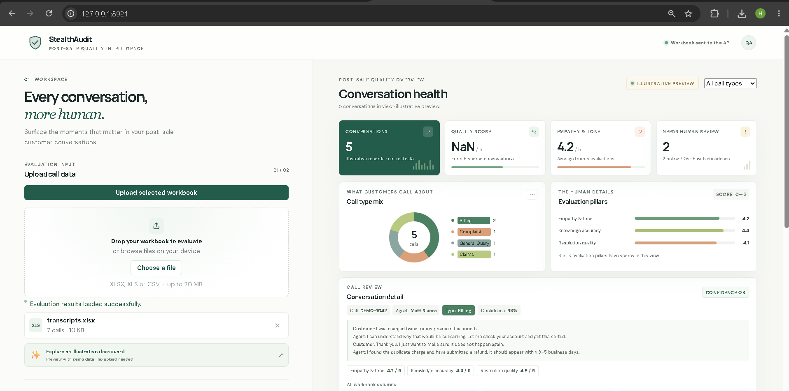

# PostSale_AI_StealthAudit
It's an automated quality assurance solution that acts as an undercover data auditor to evaluate customer satisfaction and agent behavior. 
By pulling transcripts and call logs directly from Excel, the system uses background AI to verify issue resolution and grade emotional intelligence without interrupting the support workflow.


## 🎯 Core Objectives

• Automate Quality Assurance: Eliminates manual call listening by auditing 100% of post-sale transcripts instantly.

• Validate Problem Resolution: Confirms whether the customer's post-sale issue was actually solved or left unresolved.

• Measure Soft Skills: Evaluates critical human behaviors like empathy, sympathy, patience, and tone.

• Ensure Data Reliability: Provides a confidence metric for every audit to flag complex cases for human review.


## 🔍 Key Evaluation Pillars

• Resolution Verification: Did the agent successfully address the post-sale complaint (e.g., refunds, returns, exchanges, technical troubleshooting)?

• Empathy & Sympathy Detection: Did the agent acknowledge customer frustration, use validating language, and offer genuine apologies for product/service failures?

• Behavioral & Tonal Alignment: Was the agent's language professional, calm, and reassuring, or did it shift into a defensive or dismissive tone?

• Confidence Calibration: A percentage metric indicating the AI's certainty. Low confidence scores trigger an automatic flag for human QA supervisors to review manually.

## Pre-Requisuite
Execute in CMD terminal to get latest packages
```
> uv init (initialize folder, file strucutre for .toml file and package system)
```

# uv init generates the following layout:
```
my-project/
├── .gitignore         # Configured to ignore virtual environments (.venv) and build artifacts
├── .python-version    # Pins the specific Python version used by the project
├── pyproject.toml     # The central configuration file for metadata and dependencies
├── README.md          # Standard project documentation file
└── src/               # Code directory (prevents accidental local imports during testing)
    └── my_project/    # Your actual importable package (uses underscores instead of dashes)
        └── __init__.py# Marks the directory as a Python package and includes a "Hello" entry point0
```

# Packages installation:
```
> uv sync (install all packages inside .toml file)
```
<div>
    
</div>

# RUN Project
```
> uv run python -m uvicorn src.postsale_ai_stealthaudit.main:app --port 8921 --reload
```

# Screenshot:
<div>
    
</div>

# Running Video:
<div>
    
</div>