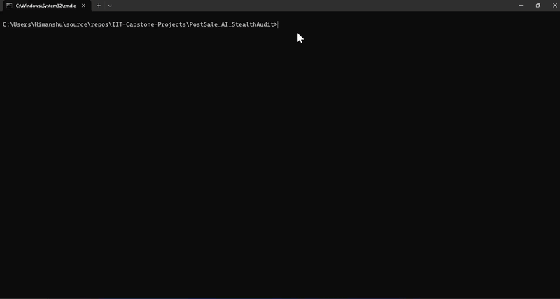

# PostSale AI StealthAudit

PostSale AI StealthAudit is a post-sale quality assurance application. It accepts customer conversation data in a CSV or Excel workbook, evaluates calls with a configured language model, and returns an enriched Excel workbook. Its browser dashboard lets a reviewer explore call classifications, evaluation scores, confidence, and transcripts.

## Project screenshots

<div>
  
</div>

The animation below shows the dashboard experience:

<div>
  
</div>

## Core objectives

- **Automate quality assurance:** Evaluate post-sale conversation transcripts using configured LLM prompts.
- **Check issue resolution:** Assess whether the agent resolved the customer's issue and explained next steps.
- **Measure service quality:** Score empathy and tone, knowledge accuracy, and resolution quality.
- **Support human review:** Include a classification confidence score so reviewers can identify calls that may need closer inspection.

## Architecture and file guide

```text
PostSale_AI_StealthAudit/
├── config/
│   └── config.json                         # LLM provider/model and classification labels
├── data/
│   ├── input-*.xlsx                        # Example input workbooks
│   ├── output*.xlsx                        # Example/generated result workbooks
│   └── <generated-upload>.csv|xlsx         # Uploaded files saved during processing
├── frontend/
│   ├── index.html                          # Dashboard markup and controls
│   ├── index.js                            # Upload, workbook parsing, and dashboard logic
│   └── style.css                           # Dashboard layout and visual styling
├── images/
│   ├── uiScreenshot.png                    # README dashboard screenshot
│   └── output.gif                          # Dashboard demo animation
├── src/postsale_ai_stealthaudit/
│   ├── main.py                             # FastAPI app, routes, and static frontend
│   ├── processor/
│   │   ├── business.py                     # Upload validation, spreadsheet I/O, pipeline call
│   │   └── pipeline.py                     # Creates and executes the AI evaluation pipeline
│   ├── components/
│   │   ├── classification.py               # Classification, routing, scoring, final reports
│   │   └── evaluation.py                    # Pydantic schemas and LLM prompt chains
│   └── utility/
│       ├── loadconfig.py                    # Loads .env and config/config.json
│       └── loadllm.py                       # Builds the configured chat model
├── pyproject.toml                           # Python project metadata and dependencies
├── uv.lock                                  # Locked dependency versions
└── README.md
```

### Request flow: UI to API and back

The following diagram shows the main upload path, the processing methods in call order, and the response path back to the dashboard.

```text
User selects or drops workbook
        |
        v
frontend/index.html controls
        |
        v
frontend/index.js: selectFile(file)
  - Checks extension and 20 MB browser limit
        |
        v
frontend/index.js: importFile()
  - Sends multipart POST to http://127.0.0.1:8921/uploadfile
        |
        v
main.py: evaluate_file(file)
  - Calls process_main(file)
        |
        v
business.py: process_main(file)
  - Validates .csv/.xlsx, saves upload, reads DataFrame
        |
        v
pipeline.py: run_full_pipeline(df)
  - load_config() -> load_llm() -> build chains
        |
        +--> run_classification(df, classification_chain)
        |      - Predicts call type and classification confidence
        |
        +--> apply_routing(df)
        |      - Adds evaluation_plan for each call
        |
        +--> apply_evaluations(df, tone, knowledge, resolution)
        |      - run_evaluations() scores each planned criterion
        |
        +--> apply_final_reports(df, final_chain)
               - generate_final_report() creates summary/recommendations
        |
        v
business.py: process_main(file)
  - Writes the result to data/output.xlsx
        |
        v
main.py: evaluate_file(file)
  - Returns output.xlsx as an Excel file response
        |
        v
frontend/index.js: parseWorkbook(buffer)
  - readRecord() maps workbook columns into dashboard records
        |
        v
setDataset(records) -> updateDashboard()
  - Renders metrics, filters, call list, charts, and selected transcript
```

### Method guide

#### API and processing

| Method | What it does |
|---|---|
| `main.root()` (`GET /`) | Serves `frontend/index.html` as the application page. |
| `main.root()` (`GET /healthcheck`) | Returns a short message indicating that the API is running. |
| `main.evaluate_file(file)` | Handles `POST /uploadfile`, calls `process_main()`, and returns the generated Excel workbook. |
| `business.process_main(file)` | Validates and saves the uploaded file, reads it into a pandas DataFrame, runs the pipeline, and writes `data/output.xlsx`. |
| `pipeline.run_full_pipeline(df)` | Loads configuration and the LLM, constructs the chains, and runs classification, routing, evaluations, and final reports in sequence. |
| `loadconfig.load_config(config_path)` | Loads environment variables and reads the JSON configuration file (by default, `config/config.json`). |
| `loadllm.load_llm(config)` | Creates a LangChain chat model for the configured Ollama, Gemini, or OpenAI provider. |

#### Classification, evaluation, and reporting

| Method | What it does |
|---|---|
| `get_classification_chain(llm, config)` | Builds the prompt and structured parser used to classify transcripts into the configured call-type labels. |
| `run_classification(df, classification_chain)` | Runs classification for each row and merges predicted call type and confidence into the DataFrame. |
| `route_call(call_type)` | Chooses the evaluation criteria for a call. Its current first return selects all three criteria for every call. |
| `apply_routing(df)` | Applies `route_call()` to each predicted call type and adds an `evaluation_plan` column. |
| `get_tone_chain(llm)` | Builds the structured prompt chain that scores agent tone and empathy from 1 to 5. |
| `get_knowledge_chain(llm)` | Builds the structured prompt chain that scores the accuracy and clarity of agent information from 1 to 5. |
| `get_resolution_chain(llm)` | Builds the structured prompt chain that scores issue resolution and communicated next steps from 1 to 5. |
| `run_evaluations(transcript, eval_plan, ...)` | Runs the criteria in one call's evaluation plan and collects each score and its reasoning. |
| `apply_evaluations(df, ...)` | Evaluates every row, merges pillar scores and evaluation details, and calculates an average overall score. |
| `get_final_report_chain(llm)` | Builds a structured prompt chain for an overall performance summary and actionable recommendations. |
| `generate_final_report(evaluation_output, final_chain)` | Generates the summary and recommendations for one call. |
| `apply_final_reports(df, final_chain)` | Generates and merges the final report for each row in the DataFrame. |

#### Browser dashboard

| Method | What it does |
|---|---|
| `selectFile(file)` | Validates the selected file's extension and browser-side size limit, then updates the upload status. |
| `importFile()` | Sends the pending file to `/uploadfile`, reads the returned workbook, and loads its records into the dashboard. |
| `parseWorkbook(buffer)` | Finds a non-empty worksheet, reads its header and data rows, and converts them into dashboard records. |
| `readRecord(row, headers, index)` | Maps workbook values using column aliases and normalizes call ID, agent, transcript, scores, confidence, and other fields. |
| `setDataset(records, options)` | Stores imported or demo records, resets selection and category filtering, and refreshes the dashboard. |
| `updateDashboard()` | Recalculates metrics and refreshes the filters, call list, charts, and selected-call view. |
| `renderFilter(categories)` | Rebuilds the call-type dropdown from the available categories. |
| `renderCallList()` | Displays searchable, category-filtered call records and handles call selection. |
| `renderCategoryChart(records)` | Renders the call-type distribution for the current view. |
| `renderPillarChart(records)` | Displays the average scores for empathy/tone, knowledge, and resolution. |
| `renderSelectedCall()` | Shows the selected call's transcript, metadata, evaluation details, and original workbook fields. |
| `loadDemo()` | Loads illustrative in-browser sample records without uploading a file or running AI evaluation. |
| `clearFile()` | Clears the loaded and pending data, then resets the dashboard to its empty state. |

The browser also uses small formatting and calculation helpers for header normalization, column lookup, score parsing, averages, labels, and chart colors.

#### Browser helpers and event handlers

| Method or handler | What it does |
|---|---|
| `normalizeHeader(value)` / `findColumn(headers, aliases)` | Normalize workbook headings and locate a matching column from the supported aliases. |
| `parseNumber(value)` / `parseConfidence(value)` | Convert score and confidence values from workbook cells into normalized numbers. |
| `setFileStatus(message, kind)` / `formatBytes(bytes)` | Update the upload status message and display a file size in KB or MB. |
| `formatLabel(value)` | Convert category identifiers into readable labels for the dashboard. |
| `getCategoryColor(category)` / `applyCategoryColor(element, category)` | Look up a category's assigned color and apply it with readable foreground contrast. |
| `getAverage(records, key)` / `formatScore(score)` / `getProgressWidth(score)` | Calculate a score average and format score/progress-bar values for display. |
| `getFilteredRecords()` | Return records matching the selected call-type filter. |
| `appendMeta(label, value, category)` | Add a metadata chip to the selected conversation details. |
| Browse, file-input, dropzone, and upload handlers | Open the file chooser, accept drag-and-drop, validate a selected file, and trigger `importFile()`. |
| Search, category-filter, call-list, clear, and demo handlers | Refresh matching calls, update the selected category/call, clear the dataset, or load the illustrative preview. |

## Input and output

- Backend uploads currently accept `.csv` and `.xlsx` files.
- The backend expects columns named `call_id` and `transcript` because the pipeline reads these fields directly.
- The browser file picker lists `.xls` too, but the backend rejects `.xls`; use `.xlsx` or `.csv`.
- Classification labels and LLM provider/model settings are read from `config/config.json`.
- The generated workbook is written to the fixed path `data/output.xlsx` and returned to the browser.
- Dashboard workbook parsing recognizes common aliases for call IDs, transcripts, agents, call types, scores, confidence, and resolution fields.
- The demo dashboard data is illustrative only; it is not generated by the AI pipeline.

## Prerequisites

- Python 3.12 or newer
- [uv](https://docs.astral.sh/uv/)
- A configured LLM provider. For Ollama, the selected model must be available locally; cloud providers require their credentials in the environment.

## Install dependencies

From the repository root, synchronize the dependencies declared in `pyproject.toml`:

```powershell
uv sync
```

## Configure the model

Edit `config/config.json` to select the provider (`ollama`, `gemini`, or `openai`), model, and classification labels. Provider credentials should be supplied through environment variables (for example, in a local `.env` file); do not commit credentials.

## Run the application

Start the API and frontend from the repository root:

```powershell
uv run uvicorn postsale_ai_stealthaudit.main:app --host 127.0.0.1 --port 8921 --reload
```

Open [http://127.0.0.1:8921](http://127.0.0.1:8921) in a browser. The health endpoint is available at [http://127.0.0.1:8921/healthcheck](http://127.0.0.1:8921/healthcheck).
